# Guía del panel de SmartOps

Para el dueño del negocio y el equipo que usa el panel todos los días. Explica qué muestra cada
pantalla y qué hacer en ella. No hace falta saber nada técnico. (English version:
[panel-guide.md](panel-guide.md).)

## Qué hace SmartOps por ti

Tus proveedores envían listas de precios por WhatsApp: texto, fotos de listas impresas, PDF,
planillas, audios. SmartOps las lee y actualiza tu catálogo solo. Cuando no está seguro de algo,
no adivina: lo deja en **Pendientes** para que decida una persona. Las consultas y los pedidos
de clientes le llegan al equipo, y el equipo recibe un resumen corto por WhatsApp en lugar de un
mensaje por cada novedad.

## Ingresar

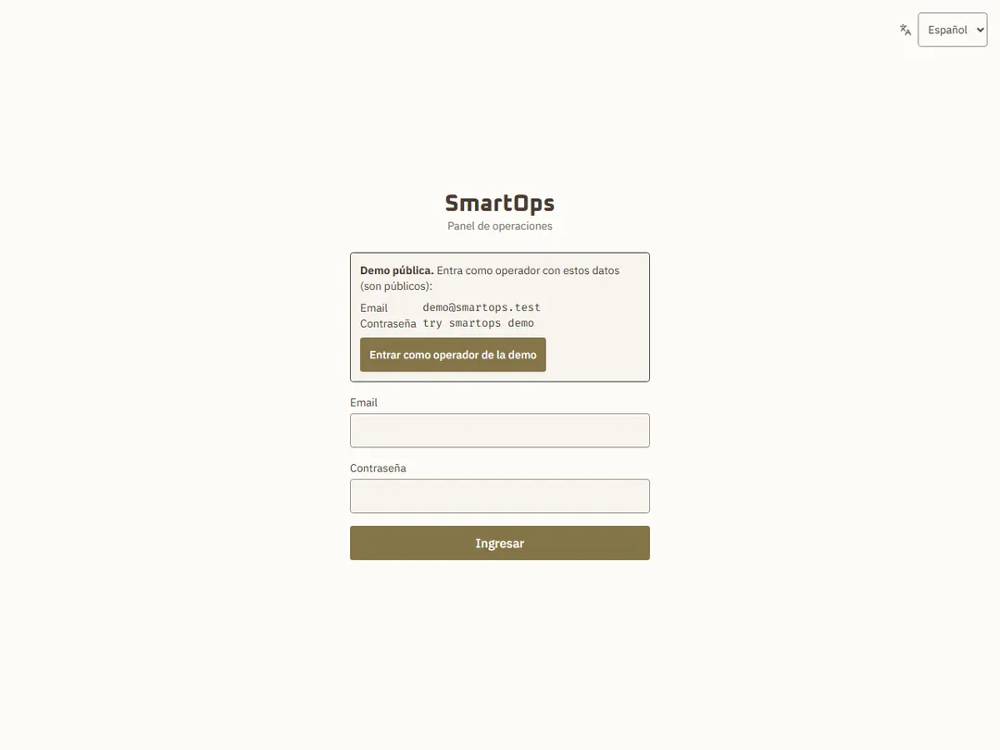

- Ingresa con tu email y tu contraseña. Las contraseñas son frases largas (mínimo 15
  caracteres); después de varios intentos fallidos la cuenta se bloquea un rato, y un
  administrador puede desbloquearla.
- **Idioma:** elige English o Español en el selector (arriba a la derecha, o en el menú de tu
  cuenta en el teléfono). El panel recuerda tu elección en todos tus dispositivos.
- **Tema:** claro, oscuro o el del dispositivo, desde el menú de tu cuenta.
- **Cerrar todas mis sesiones** (menú de tu cuenta) cierra tu sesión en todos los dispositivos,
  por ejemplo si pierdes el teléfono.

## La navegación

En una computadora las secciones están a la izquierda; en el teléfono, la barra de abajo tiene
**Inicio**, **Pendientes**, **Conversaciones** y **Catálogo**, y el resto está en **Más**. El único
número amarillo del panel es el de **Pendientes**: cuántas cosas esperan por **ti** (lo que tu rol
puede decidir).

## Inicio

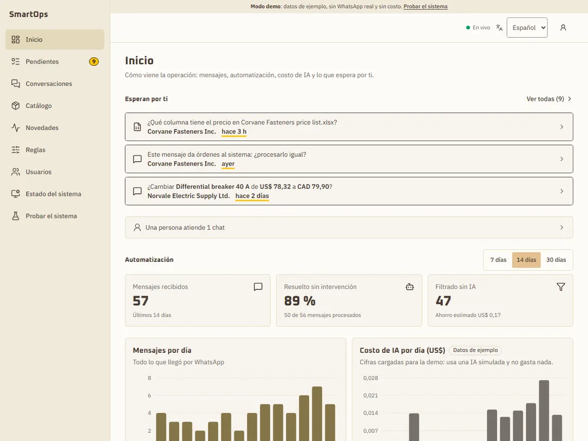

- Primero, **Esperan por ti**: las tres decisiones más nuevas que puedes tomar, cada una con su
  enlace, y **Ver todas** para abrir Pendientes. Cuando no espera nada, dice **Todo al día**.
- Debajo, solo cuando hay algo: los chats que **atiende una persona** y, para los
  administradores, una línea roja cuando hay **errores técnicos sin revisar** (abre Estado del
  sistema).
- **Automatización**, con 7, 14 o 30 días: mensajes recibidos, **resuelto sin intervención** (la
  parte de los mensajes procesados que no necesitó a nadie) y **filtrado sin IA** (saludos,
  stickers, charla de clientes que no costaron nada, con el ahorro estimado).
- Los gráficos muestran los mensajes por día y el costo de IA por día, con los presupuestos
  diario y total.

## Pendientes

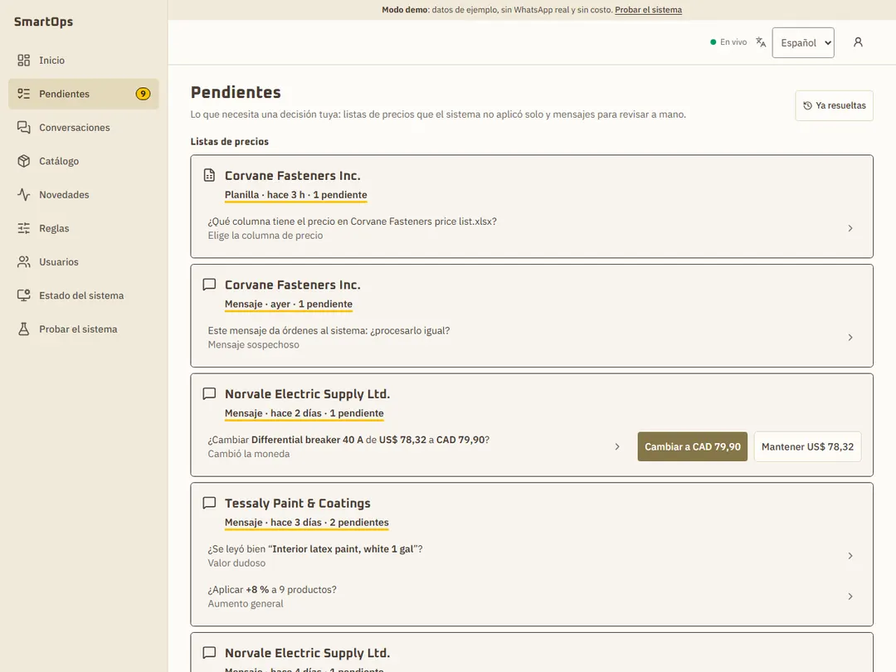

Todo lo que espera una decisión, en un solo lugar. Nada de esto se aplicó todavía al catálogo.

- **Listas de precios:** una tarjeta por cada mensaje que envió un proveedor (una foto, una
  planilla, un audio o un texto), con cuándo llegó y cuántas decisiones tiene. Cada decisión se
  lee como una pregunta, por ejemplo "¿Actualizar Arena gruesa a $ 1.850,00?". **Ver todas**
  muestra el resto de una lista larga.
- **Un clic:** cuando la respuesta no necesita elegir nada — un cambio de precio o de moneda de un
  producto que el sistema ya identificó, o marcar un producto como no disponible
  (administradores) — dos botones lo deciden ahí mismo, con el valor escrito: **Actualizar a
  $ 1.850,00** / **Mantener $ 1.650,00**. Lo demás (qué producto es, un mensaje más antiguo, un
  valor dudoso…) se abre con un clic.
- **Mensajes para revisar:** un audio demasiado largo para transcribir (**Escuchar en el chat** y
  después **Listo**) o una frase que puede ser una baja (**No es una baja**, o **Dar de baja**
  después de confirmar: solo un administrador puede volver a dar de alta a un contacto).
- **Esperan a un administrador:** lo que un operador no puede decidir (afecta una lista entera o
  todo el catálogo) queda plegado al final, y una lista que tiene algo así dice "+1 espera a un
  administrador". **En la demo pública** esa sección no existe: el operador compartido puede probar
  todas las revisiones, y las que en una instalación real quedan para un administrador lo dicen
  ("En una instalación real, esto lo resuelve un administrador"). Cuando no queda nada,
  Pendientes ofrece **Probar el sistema** y **Reiniciar demo**.
- **Ya resueltas** muestra las decisiones ya tomadas (aprobadas y rechazadas).

**Una línea de producto, en su detalle** (por ejemplo, un cambio de precio fuera de lo normal):

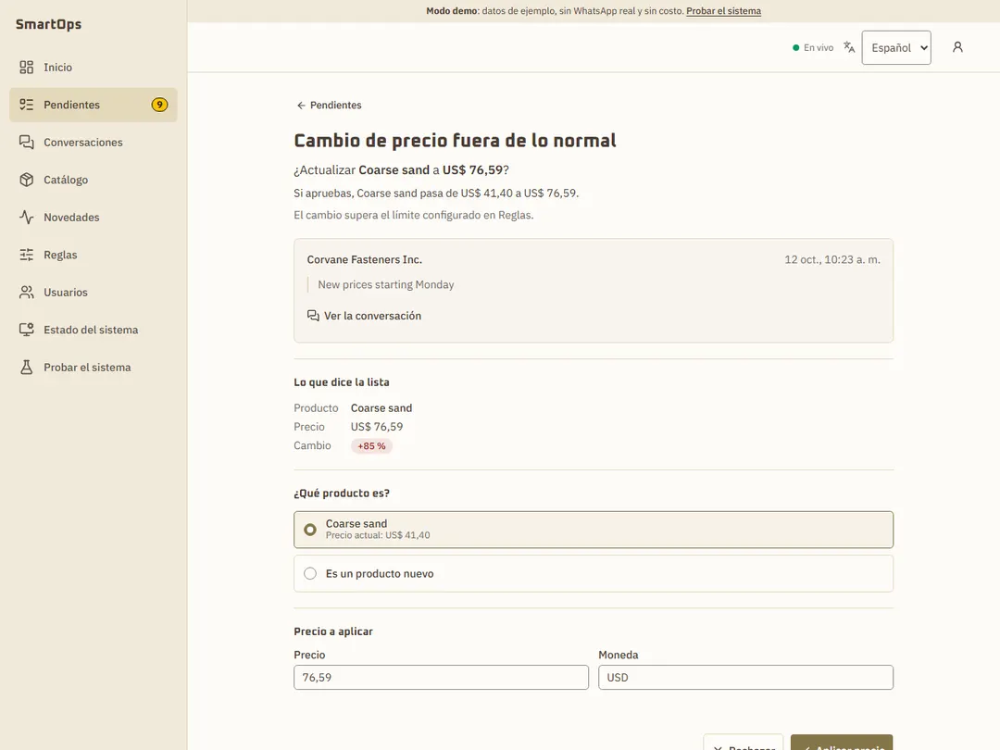

1. Lee lo que dice la lista y el mensaje original (el enlace abre la conversación).
2. Elige qué producto es, o "Es un producto nuevo".
3. Revisa o corrige el precio y toca **Aplicar precio**. Escribe los precios sin punto de miles
   (1850 o 1850,50): un "1.850" ambiguo se rechaza a propósito.
4. **Rechazar** si está mal; puedes dejar una nota para el equipo.

**Un formato de planilla nuevo**: la primera vez que un proveedor manda una planilla con otra
forma, eliges qué columna de precio va al catálogo. Cada opción muestra valores reales del
archivo, y la sugerida viene marcada. Después, las planillas con la misma forma se leen solas,
sin IA y sin costo.

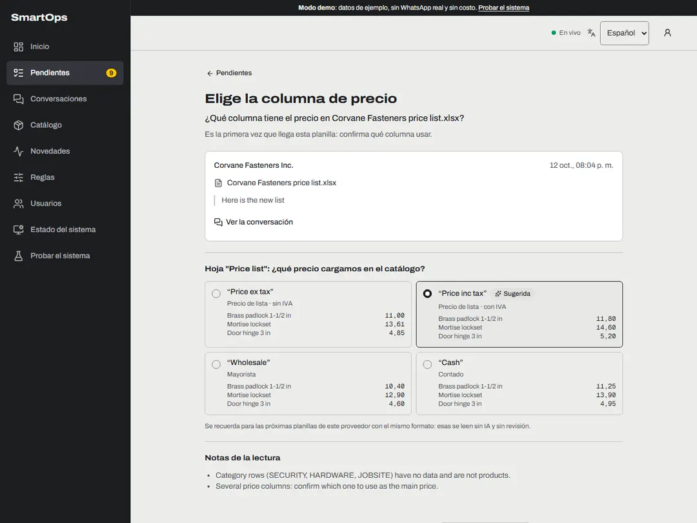

Otras revisiones que puedes ver: "¿Es este producto?", un producto que falta en una lista
completa ("¿Marcar como no disponible?"), un aumento general ("todo +8 %"), un cambio del IVA de
la lista, y un **mensaje sospechoso** que intenta darle órdenes al sistema (no se aplicó nada;
léelo antes de procesarlo).

Los operadores resuelven líneas de producto. Las revisiones que afectan una lista entera o todo el
catálogo son para administradores (en la demo pública el operador también puede resolverlas, con
una nota que lo aclara).

## Conversaciones

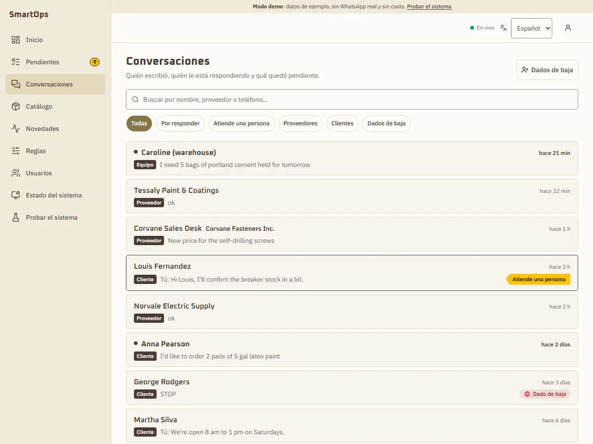

- Cada chat muestra quién está respondiendo: 🤖 **responde el bot**, 👤 **atiende una persona**
  (hasta una hora), o ⛔ **dado de baja**.
- Un punto y el nombre en negrita marcan un chat que **está por responder**: un cliente o alguien del
  equipo preguntó algo o hizo un pedido y ninguna persona le contestó todavía (desde el panel o desde
  el teléfono). Las listas de precios, los «ok» y los «gracias» nunca marcan un chat. El filtro **Por
  responder** muestra solo esos, y funciona junto con la búsqueda.
- Busca por nombre, proveedor o teléfono, y filtra por tipo.

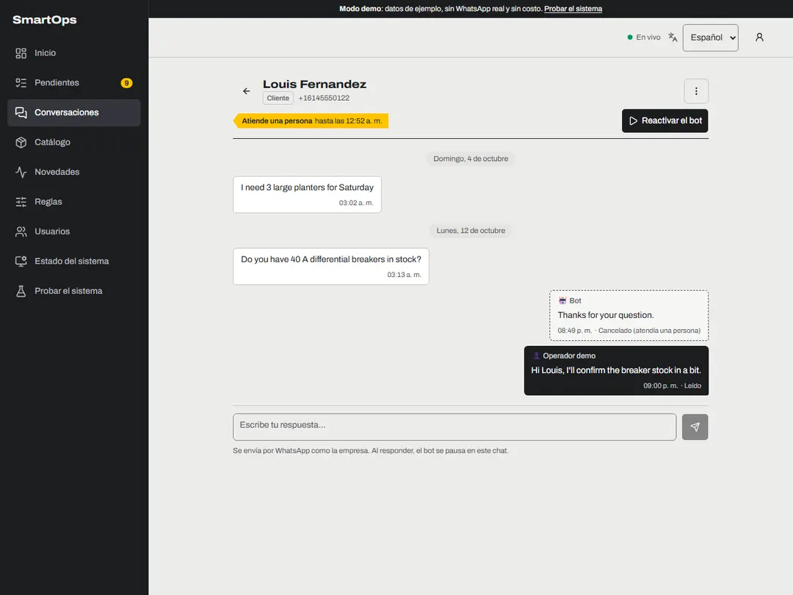

- **Responder como persona** desde el cuadro de abajo. Se envía por WhatsApp como la empresa, y
  el bot se pausa en ese chat (por defecto, 2 horas desde tu último mensaje). WhatsApp solo
  permite respuestas libres dentro de las 24 horas del último mensaje del contacto; el panel te
  avisa cuando la ventana está cerrada.
- **Pausar el bot** (30 minutos, 2 horas, 8 horas o hasta que lo reactives) y **Reactivar el
  bot** cuando quieras.
- La respuesta de una persona solo pausa las respuestas automáticas: las listas de precios de ese
  contacto se siguen procesando y el equipo sigue recibiendo avisos.
- **Bajas:** si un contacto escribe BAJA o STOP, deja de recibir mensajes automáticos. También
  puedes registrar una baja a mano (menú ⋮). Solo un administrador vuelve a dar de alta a
  alguien. La lista de contactos dados de baja está en **Dados de baja**.

## Catálogo

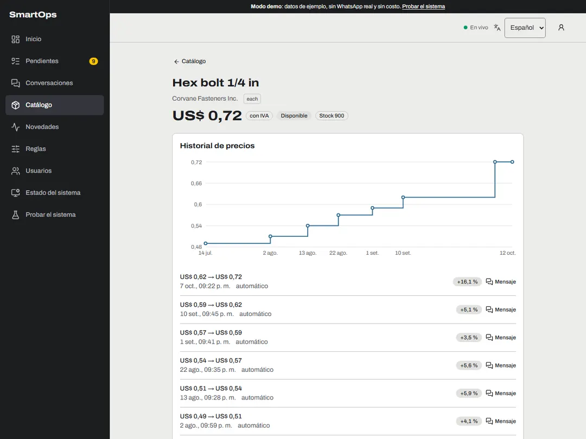

- Los productos de cada proveedor con su último precio y su último cambio. Busca por nombre o
  filtra por proveedor y disponibilidad.
- Abre un producto para ver su historial de precios: el gráfico y la lista de cambios, cada uno
  con un enlace al mensaje que lo causó.
- Los administradores pueden **renombrar un proveedor** (por ejemplo, cuando se creó con el
  nombre de WhatsApp).

## Novedades

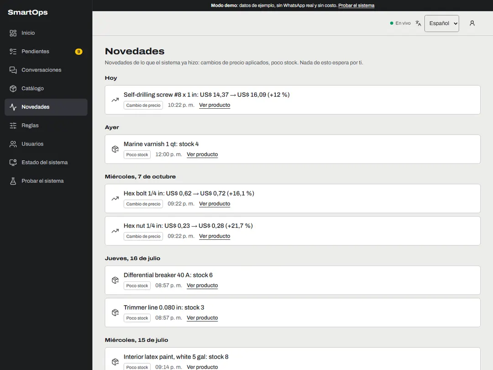

Lo que el sistema ya hizo, agrupado por día (**Hoy**, **Ayer**, la fecha): los cambios de precio que
aplicó y los productos con poco stock, cada uno con un enlace al producto. Nada de esto espera por
ti: no hay nada que marcar como visto.

## Estado del sistema

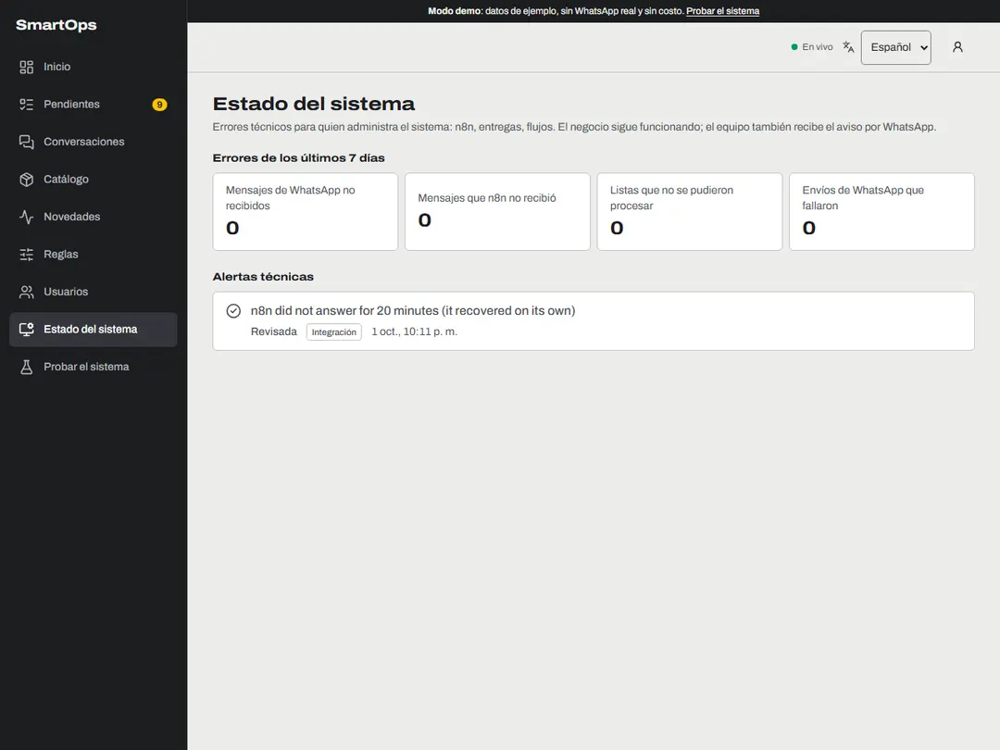

Para quien administra el sistema (administradores; en la demo pública, solo lectura): los errores
de los últimos 7 días — mensajes de WhatsApp no recibidos, mensajes que n8n no recibió, listas que
no se pudieron procesar, envíos de WhatsApp que fallaron — y las alertas técnicas. Las **sin
revisar** van en rojo; un administrador marca cada una como **revisada** cuando la resuelve, y pasa
a gris. Los errores graves también le llegan al equipo por WhatsApp.

## Reglas

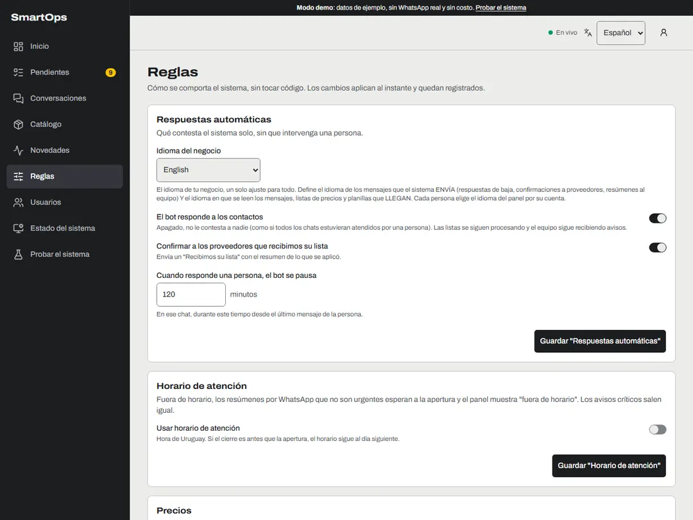

Cómo se comporta el sistema, sin tocar código. Los cambios aplican al instante y quedan
registrados. Solo los administradores pueden cambiarlas.

- **Respuestas automáticas:** el idioma de los mensajes de WhatsApp, el bot prendido o apagado,
  la confirmación a los proveedores de que llegó su lista, y cuánto tiempo queda pausado el bot
  después de que responde una persona.
- **Horario de atención:** fuera de horario, los resúmenes por WhatsApp que no son urgentes
  esperan a la apertura.
- **Precios:** desde qué porcentaje un cambio genera una alerta, y desde qué aumento o baja un
  precio espera una revisión; crear productos nuevos automáticamente.
- **Avisos al equipo por WhatsApp:** quién recibe los resúmenes, cada cuánto, y los límites por
  hora.
- **Audios y bajas:** el audio más largo que se transcribe automáticamente, y las palabras de
  baja y de alta.

## Usuarios (administradores)

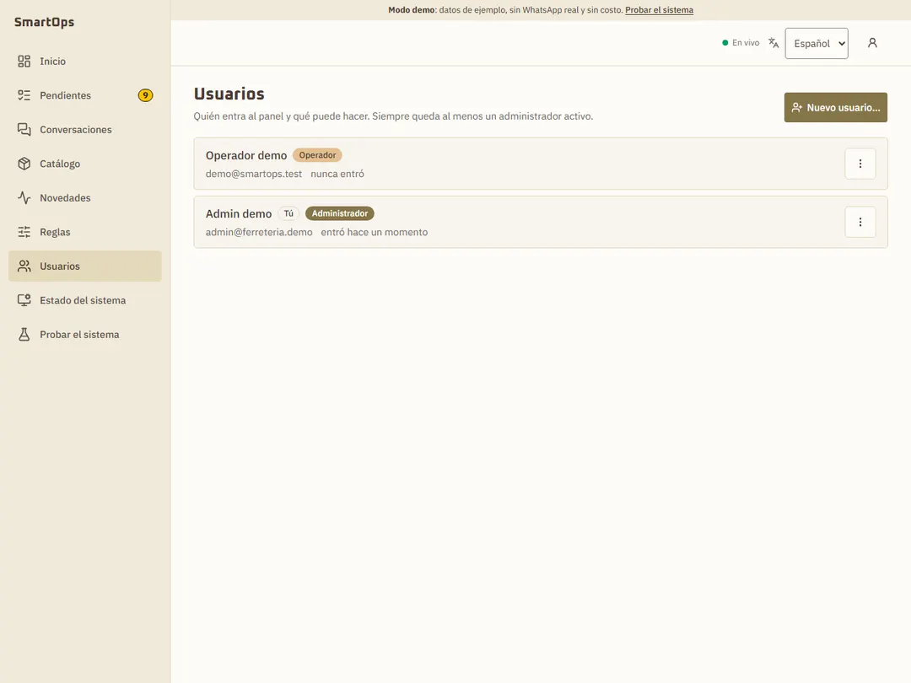

- Crea usuarios como **operador** (líneas de producto en Pendientes, y conversaciones) o
  **administrador** (todo, incluidas las listas enteras, el catálogo, las reglas, el Estado del
  sistema y los usuarios).
- Cambia roles, desactiva, pon una contraseña nueva, desbloquea o cierra las sesiones de un
  usuario. Cada cambio de rol, desactivación o contraseña nueva cierra las sesiones de ese
  usuario.
- Nadie puede cambiar su propio rol ni desactivarse, y siempre queda al menos un administrador
  activo.

## El resumen por WhatsApp

El equipo recibe un mensaje por período (10 minutos por defecto) con lo que requiere acción:
pedidos, consultas de clientes, listas con cambios grandes o revisiones pendientes, y errores. El
enlace del final abre las pantallas correspondientes del panel (primero pide ingresar).

## Lo que SmartOps nunca hace

- Nunca inventa un precio ni adivina un valor dudoso: pregunta en Pendientes.
- Nunca aplica instrucciones escritas dentro de un mensaje o de un archivo.
- Nunca les escribe a los contactos dados de baja, salvo la única confirmación.
- Nunca envía más de los límites que pongas en Reglas.
