# SmartOps panel guide

For the business owner and the team who use the panel every day. It explains what each screen
shows and what to do in it. No technical knowledge is needed. (Versión en español:
[guia-del-panel.md](guia-del-panel.md).)

## What SmartOps does for you

Your suppliers send price lists over WhatsApp: text, photos of printed lists, PDFs,
spreadsheets, voice notes. SmartOps reads them and updates your catalog by itself. When it is not
sure about something, it does not guess: it leaves it in **To do** for a person to decide.
Customers' questions and orders are passed on to the team, and the team gets a short WhatsApp
summary instead of one message per event.

## Signing in

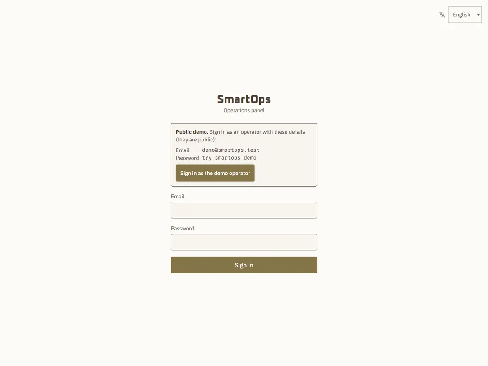

- Sign in with your email and password. Passwords are long phrases (at least 15 characters);
  after several failed attempts the account is locked for a while, and an administrator can
  unlock it.
- **Language:** choose English or Español in the selector (top right, or in your account menu on
  a phone). The panel remembers your choice on every device.
- **Theme:** light, dark or the device's, from your account menu.
- **Sign out everywhere** (account menu) closes your sessions on every device, for example after
  losing a phone.

## The navigation

On a computer the sections are on the left; on a phone the bottom bar has **Home**, **To do**,
**Conversations** and **Catalog**, and the rest is under **More**. The only yellow number in the
panel is the one on **To do**: how many things wait for **you** (what your role can decide).

## Home

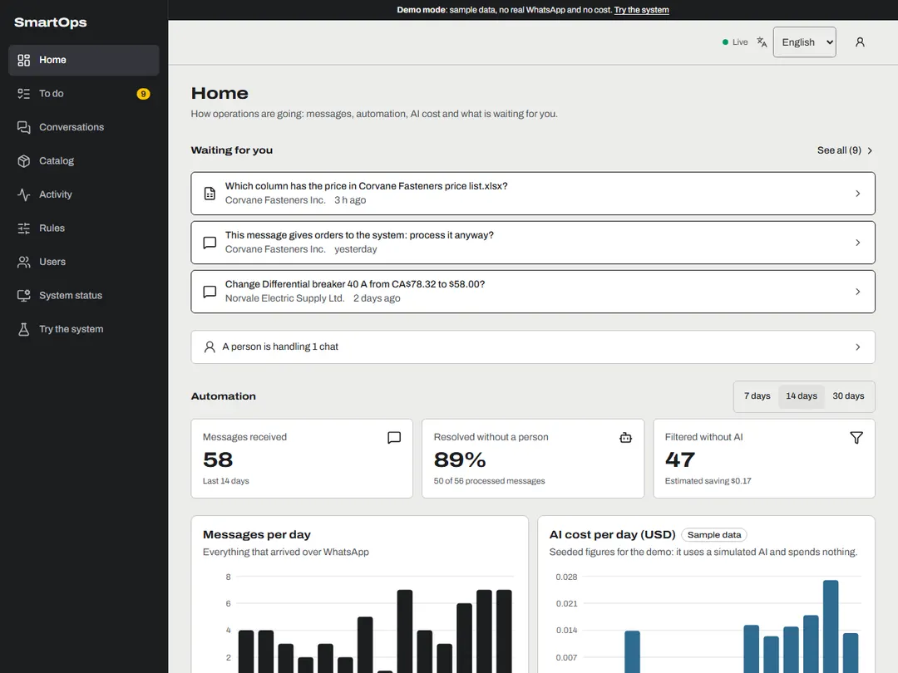

- **Waiting for you** comes first: the three newest decisions you can take, each a link, and
  **See all** to open To do. When nothing waits, it says **All caught up**.
- Below, only when there is something: the chats **a person is handling**, and — for
  administrators — a red line when there are **technical errors not reviewed** (it opens System
  status).
- **Automation**, with 7, 14 or 30 days: messages received, **resolved without a person** (the
  share of processed messages that needed nobody) and **filtered without AI** (greetings,
  stickers, customers' chat that never cost anything, with the estimated saving).
- The charts show messages per day and the AI cost per day, with the daily and total budgets.

## To do

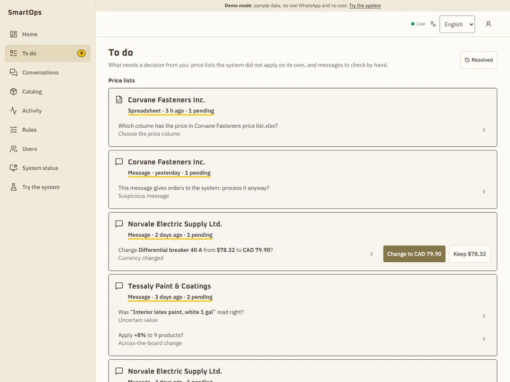

Everything that waits for a decision, in one place. Nothing in it has been applied to the catalog
yet.

- **Price lists:** one card per message a supplier sent (a photo, a spreadsheet, a voice note or a
  text), with when it arrived and how many decisions it has. Each decision reads as a question,
  for example "Update Coarse sand to $41.50?". **View all** shows the rest of a long list.
- **One click:** when the answer needs no choice — a price change or a currency change of a product
  the system already identified, or marking a product as unavailable (administrators) — two
  buttons decide it right there, with the value on them: **Update to $41.50** / **Keep $38.00**.
  Anything else (which product it is, an older message, a doubtful value…) opens with a click.
- **Messages to check:** a voice note too long to transcribe (**Listen in the chat**, then
  **Done**) or a phrase that may be an opt-out (**Not an opt-out**, or **Opt out** after a
  confirmation — only an administrator can opt a contact back in).
- **Waiting for an administrator:** what an operator cannot decide (it affects a whole list or the
  entire catalog) is folded at the end, and a list that has one says "+1 waits for an
  administrator".
- **Resolved** shows the decisions already taken (approved and rejected).

**A product line, in its detail** (for example, an unusual price change):

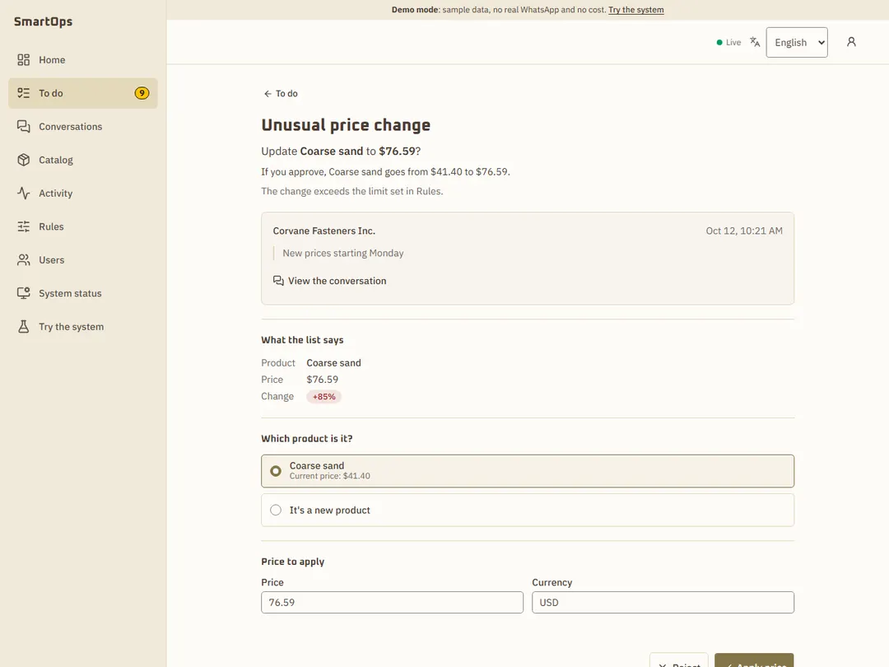

1. Read what the list says and the original message (the link opens the conversation).
2. Choose which product it is, or "It's a new product".
3. Check or correct the price, then **Apply price**. Type prices without a thousands separator
   (1850 or 1850.50): an ambiguous "1,850" is refused on purpose.
4. **Reject** if it is wrong; you can leave a note for the team.

**A new spreadsheet format**: the first time a supplier sends a spreadsheet with a new layout,
you choose which price column goes into the catalog. Each option shows real values from the
file, and the suggested one is pre-selected. After that, spreadsheets with the same layout are read
by themselves, without AI and at no cost.

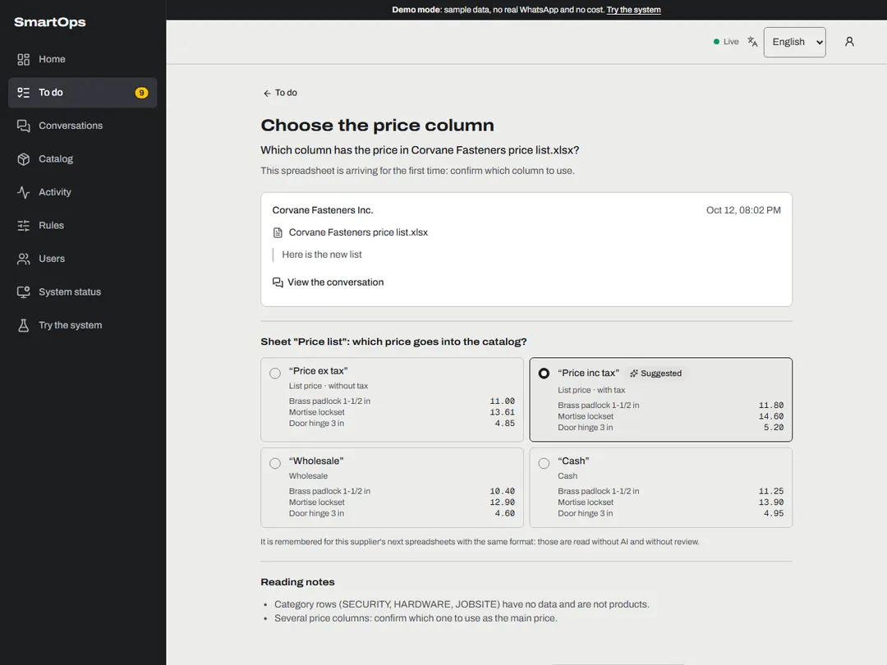

Other reviews you may see: "Is it this product?", a product missing from a full list ("Mark as
unavailable?"), an across-the-board change ("everything +8 %"), a change of tax basis, and a
**suspicious message** that tries to give orders to the system (nothing was applied; read it
before processing it).

Operators resolve product lines. Reviews that affect a whole list or the whole catalog are for
administrators.

## Conversations

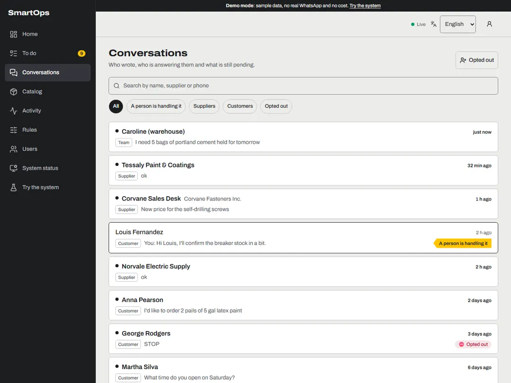

- Each chat shows who is answering: 🤖 **the bot answers**, 👤 **a person is handling it** (until
  a time), or ⛔ **opted out**.
- A dot and bold name mark a chat that **needs a reply**: a customer or a team member asked something
  or placed an order and no person has answered yet (from the panel or from the phone). Price lists,
  "ok" and "thanks" never mark a chat. The **Needs a reply** filter shows only those, and it works
  together with the search.
- Search by name, supplier or phone, and filter by type.

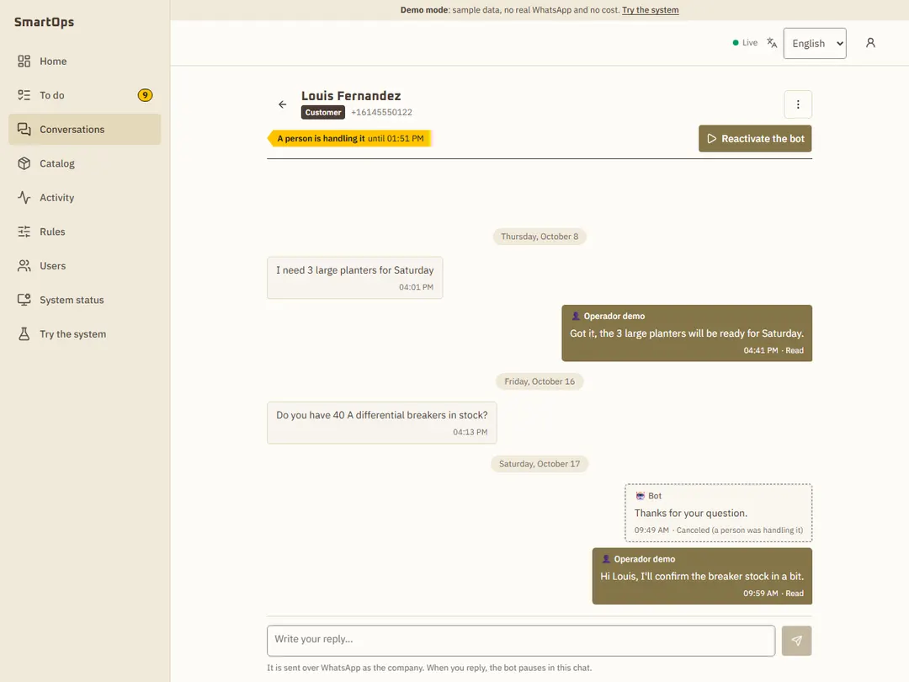

- **Reply as a person** from the box at the bottom. It is sent over WhatsApp as the company, and
  the bot pauses in that chat (by default for 2 hours after your last message). WhatsApp only
  allows free replies within 24 hours of the contact's last message; the panel tells you when
  the window is closed.
- **Pause the bot** (30 minutes, 2 hours, 8 hours or until you reactivate it) and **Reactivate
  the bot** at any time.
- A person's reply only pauses the automatic answers: the contact's price lists are still
  processed and the team still gets alerts.
- **Opt-outs:** if a contact writes BAJA or STOP, they stop receiving automatic messages. You can
  also record an opt-out by hand (menu ⋮). Only an administrator records an opt-in again. The
  list of opted-out contacts is under **Opted out**.

## Catalog

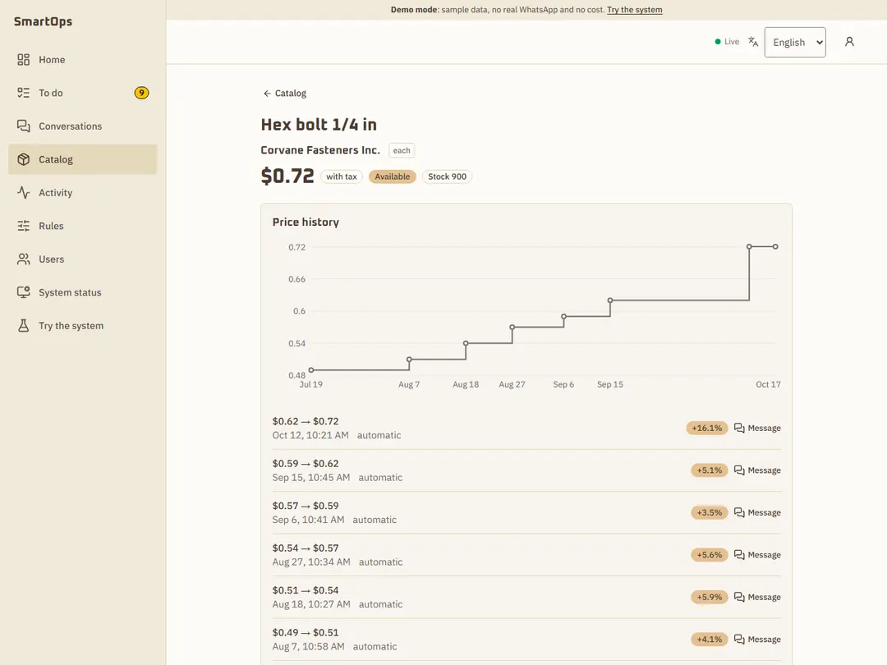

- Every supplier's products with their last price and last change. Search by name or filter by
  supplier and availability.
- Open a product to see its price history: the chart and the list of changes, each with a link to
  the message that caused it.
- Administrators can **rename a supplier** (for example, when it was created with a WhatsApp
  name).

## Activity

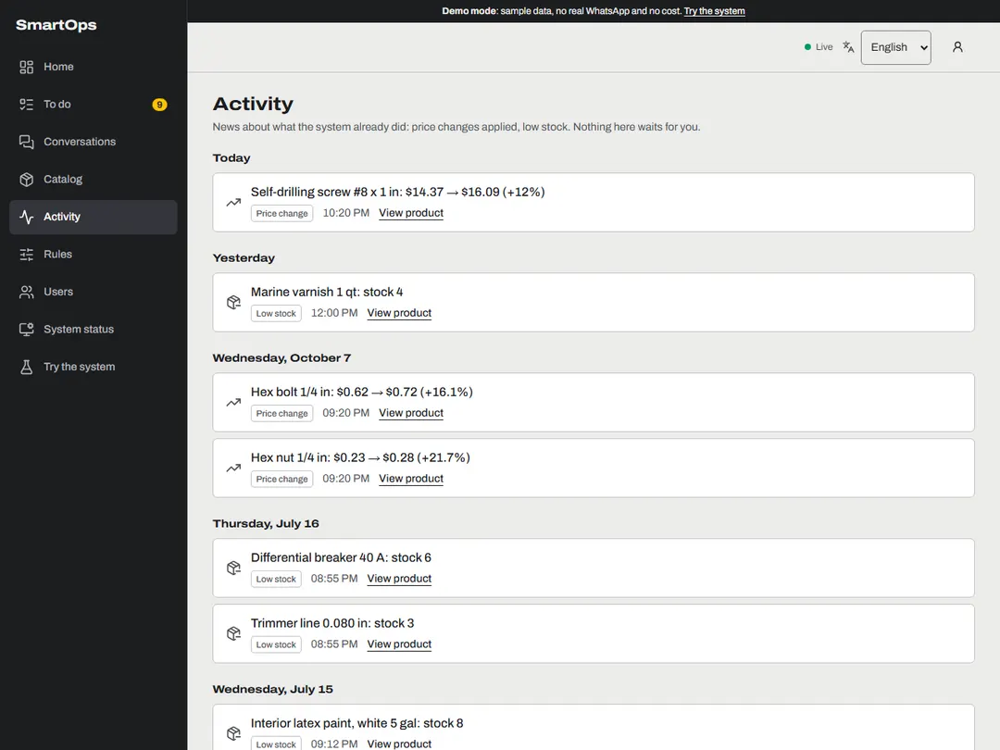

News about what the system already did, grouped by day (**Today**, **Yesterday**, the date): price
changes it applied and products with low stock, each with a link to the product. Nothing here waits
for you: there is nothing to mark as seen.

## System status

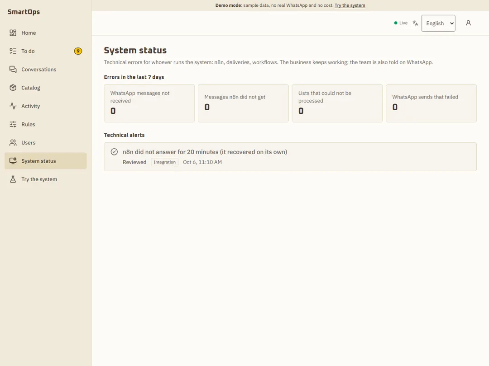

For whoever runs the system (administrators; in the public demo, read-only): the errors of the last
7 days — WhatsApp messages not received, messages n8n did not get, lists that could not be
processed, WhatsApp sends that failed — and the technical alerts. Those **not reviewed** are red;
an administrator marks each one as **reviewed** once it is handled, and it turns grey. The team is
also told about serious errors on WhatsApp.

## Rules

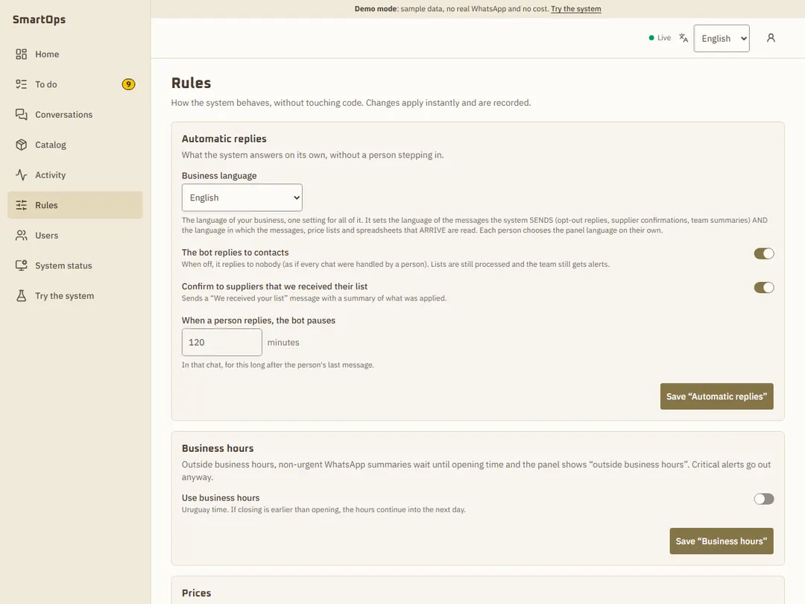

How the system behaves, without touching code. Changes apply at once and are recorded. Only
administrators can change them.

- **Automatic replies:** the language of WhatsApp messages, the bot on or off, confirming to
  suppliers that their list arrived, and how long the bot stays paused after a person replies.
- **Business hours:** outside them, non-urgent WhatsApp summaries wait until opening time.
- **Prices:** from what percentage a change raises an alert, and above what increase or decrease
  a price waits for review; creating new products automatically.
- **WhatsApp alerts to the team:** who receives the summaries, how often, and the hourly limits.
- **Voice notes and opt-outs:** the longest voice note transcribed automatically, and the
  opt-out and opt-in words.

## Users (administrators)

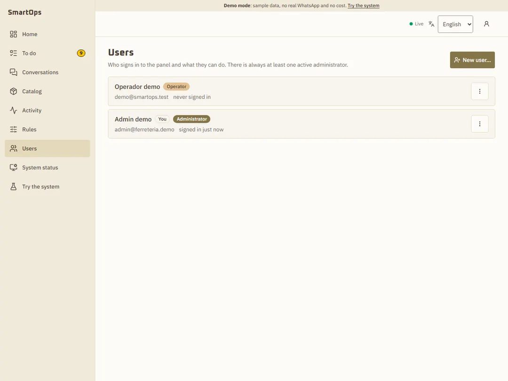

- Create users as **operator** (product lines in To do, and conversations) or **administrator**
  (everything, including whole lists, the catalog, rules, System status and users).
- Change roles, deactivate, set a new password, unlock, or close a user's sessions. Every change
  of role, deactivation or new password closes that user's sessions.
- Nobody can change their own role or deactivate themselves, and there is always at least one
  active administrator.

## The WhatsApp summary

The team receives one message per period (10 minutes by default) with what needs action: orders,
customers' questions, lists with large changes or pending reviews, and errors. The link at the
end opens the matching screens in the panel (you are asked to sign in first).

## What SmartOps never does

- It never invents a price or guesses a doubtful value: it asks in To do.
- It never applies instructions written inside a message or a file.
- It never writes to contacts who opted out, except the single confirmation.
- It never sends more than the limits you set in Rules.
